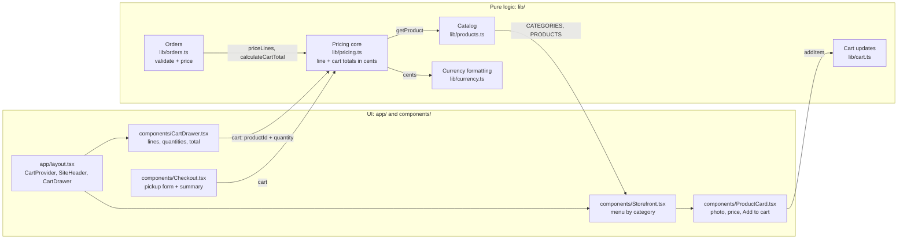
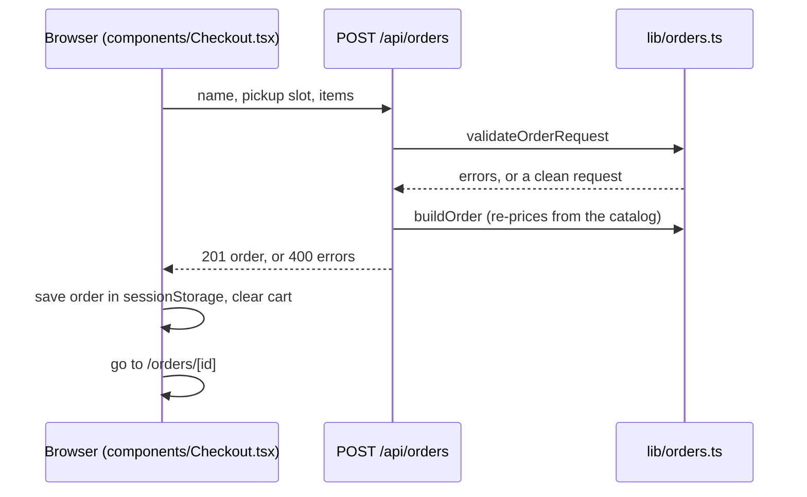

# Architecture

Bean & Byte is a single Next.js 14 (App Router) application. It has no
database and calls no external APIs: the catalog is a static list in code,
the cart lives in the browser, every price comes from a pure TypeScript
pricing core, and checkout places mock pickup orders that are never charged
or stored.

## Request and data flow

1. **Catalog.** `lib/products.ts` exports `CATEGORIES`, `PRODUCTS`, and
   `getProduct`. Each product has a category, a description, and a photo in
   `public/products/<id>.jpg`. `Storefront` renders one section per
   category and one `ProductCard` per product.
2. **Cart.** `components/CartProvider.tsx` holds the cart as `CartItem[]`
   (product id and quantity) for every page and saves it in
   `localStorage`. The quantity changes themselves are pure functions in
   `lib/cart.ts`. Cart UI only changes quantities; it never computes money.
3. **Pricing core.** `calculateLineTotal`, `priceLines`, and
   `calculateCartTotal` in `lib/pricing.ts` turn quantities into integer
   cents. A line of 3 or more of one item is 10% off, rounded to the nearest
   cent.
4. **Currency formatting.** `formatCurrency` in `lib/currency.ts` is the only
   place cents become a display string such as `$9.45`.

## Checkout

- The server never trusts client totals: `buildOrder` prices every line
  again through `lib/pricing.ts`.
- `validateOrderRequest` rejects blank or long names, unknown pickup slots,
  empty carts, unknown products, and quantities outside 1 to 99, and merges
  repeated products into one line.
- Orders are not stored. The confirmation page (`app/orders/[id]/page.tsx`)
  reads the last order from `sessionStorage` in the same tab.

## Where code lives

| Directory | Contains | Rules |
| --- | --- | --- |
| `app/` | Routes: the menu, `/checkout`, `/orders/[id]`, the root layout, `app/api/orders/route.ts`, and `app/api/health/route.ts` | UI and HTTP only; no pricing math |
| `components/` | React components (`Storefront`, `ProductCard`, `CartProvider`, `CartDrawer`, `Checkout`, `OrderConfirmation`) | Calls into `lib/` for every price |
| `lib/` | Catalog, cart updates, pricing, orders, currency, types | Pure TypeScript: no React, no I/O, integer cents |
| `public/products/` | Product photos, one JPEG per product id | 800 × 800, served through `next/image` |
| `server/` | Server-only helpers such as the JSON logger | May do I/O; never imported by client components |
| `tests/` | Vitest unit tests, one file per module | Run with `npm test` |
| `e2e/` | Playwright end-to-end tests against a production build | Run with `npm run test:e2e` |

## Server side and observability

- `app/api/health/route.ts` answers `GET /api/health` with
  `{"status":"ok"}` and logs each check through `server/logger.ts`.
- `app/api/orders/route.ts` answers `POST /api/orders` with the priced
  order (HTTP 201) or `{"errors": [...]}` (HTTP 400). It logs
  `order placed` with the order id, pickup slot, line count, and total in
  cents, and `order rejected` with the validation errors. The customer's
  name is never logged.
- `server/logger.ts` writes one JSON object per line (`timestamp`, `level`,
  `message`, extra fields) to stdout, or stderr for warnings and errors.
  Fields whose keys look sensitive (password, token, authorization, cookie,
  email, card, and similar) are replaced with `[REDACTED]`.
- `instrumentation.ts` registers OpenTelemetry tracing through `@vercel/otel`
  with the service name `bean-and-byte`. Nothing is exported by default; set
  the standard `OTEL_EXPORTER_OTLP_ENDPOINT` variable to send traces to an
  OTLP collector.

## External services

None. The app makes no outbound calls at runtime.
