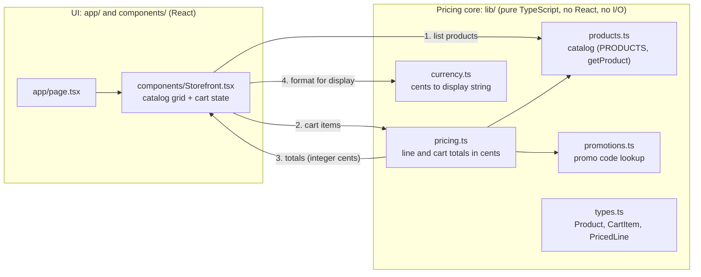

# Architecture

Bean & Byte is a single Next.js (App Router) app. There is no database, no
login, and no external API: the catalog is a constant in code and the cart
lives in React state in the browser.

## Request and data flow

1. **Catalog**: `components/Storefront.tsx` renders `PRODUCTS` from
   `lib/products.ts`.
2. **Cart**: clicking a product updates a list of `CartItem`s
   (`productId` + `quantity`) held in React state.
3. **Pricing**: `lib/pricing.ts` turns cart items into line totals and a cart
   total. All money is integer cents; buying 3 or more of one item takes 10%
   off that line, rounded to the nearest cent.
4. **Currency formatting**: `lib/currency.ts` turns cents into strings such
   as `$9.45`. The UI never formats money itself.

## Where code lives

| Directory | Contains | Rules |
| --- | --- | --- |
| `app/` | Pages, layout, global CSS, and the `/api/health` route | UI and HTTP only |
| `components/` | React components (the storefront UI) | Calls `lib/` for every calculation |
| `lib/` | Pricing core | Pure functions: no React, no I/O, fully unit tested |
| `server/` | Server-only helpers such as the JSON logger | May do I/O; never imported by client components |
| `tests/` | Vitest unit tests, one file per module | Run with `npm test` |
| `e2e/` | Playwright end-to-end tests against a production build | Run with `npm run test:e2e` |

## Server side and observability

- `app/api/health/route.ts` answers `GET /api/health` with
  `{"status":"ok"}` and logs each check through `server/logger.ts`.
- `server/logger.ts` writes one JSON object per line (`timestamp`, `level`,
  `message`, extra fields) to stdout, or stderr for warnings and errors.
  Fields whose keys look sensitive (password, token, authorization, cookie,
  email, card, and similar) are replaced with `[REDACTED]`.
- `instrumentation.ts` registers OpenTelemetry tracing through `@vercel/otel`
  with the service name `bean-and-byte`. Nothing is exported by default; set
  the standard `OTEL_EXPORTER_OTLP_ENDPOINT` variable to send traces to an
  OTLP collector.

## External services

None. The app makes no outbound calls at runtime.
