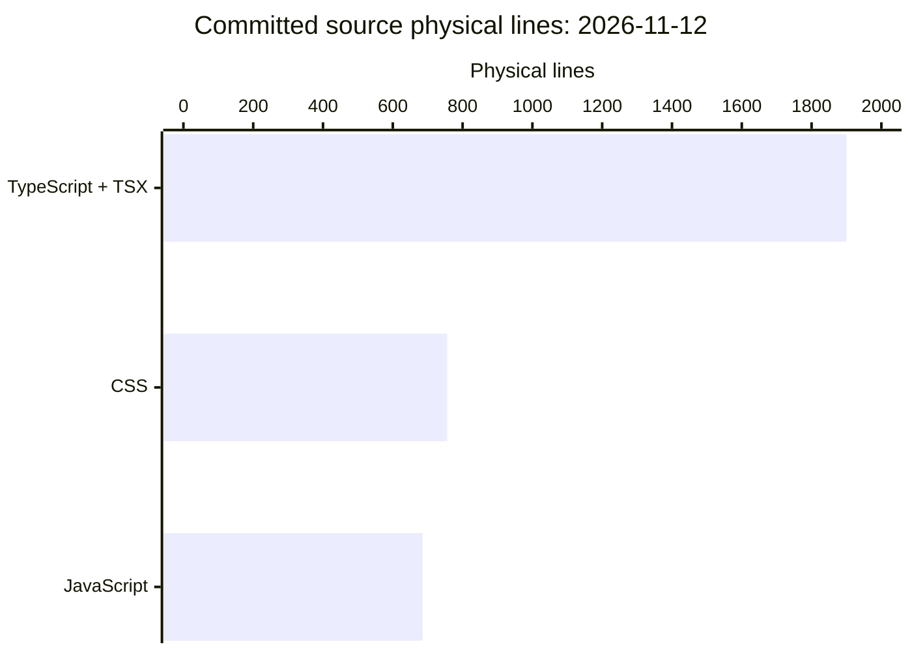

# By the numbers

Data collected on **2026-11-12**, commit [`11789b4`](https://github.com/FactoryDemo/demo-storefront-practice/commit/11789b48e07aaee25433cc2f67bb15e101c401a5). These are repository measurements, not production usage or individual contributor statistics. See [architecture](overview/architecture.md) for what the code does and [lore](lore.md) for how it grew.

## Scope and counting rules

The snapshot uses `git ls-tree -r --name-only HEAD` and each file's committed contents (`git show HEAD:<path>`), not the installed working tree or this refresh's uncommitted edits. The now-tracked `droid-wiki/` is counted separately, outside application, test, configuration, and non-wiki documentation metrics. A **physical line** is one Python `str.splitlines()` entry, including blank lines and comments; a final newline does not add an extra line, and a nonempty final line counts without a terminating newline. This is not executable LOC, statement count, or a comment-stripped estimate.

| Category | Definition | Files | Physical lines |
| --- | --- | ---: | ---: |
| Source | All tracked files under `app/`, `components/`, `lib/`, `server/`, `scripts/`, plus `instrumentation.ts`; includes CSS and operational JavaScript | 41 | 3,342 |
| Tests | `tests/` and `e2e/`: seven Vitest modules and one Playwright module | 8 | 776 |
| Configuration and automation | Remaining non-Markdown text outside `droid-wiki/`: root configs/manifests, `.github/` YAML and ownership rules, `.devcontainer/`, `.husky/`, `.env.example`, and `observability/grafana/` JSON | 35 | 1,704 |
| **Source + tests + configuration** | Disjoint categories above | **84** | **5,822** |
| Documentation | Tracked Markdown outside `droid-wiki/`, including `AGENTS.md`, `README.md`, `docs/`, GitHub templates, and `.factory/skills/storefront-qa/SKILL.md` | 9 | 586 |
| Generated wiki | Tracked `droid-wiki/`: 31 Markdown pages (1,670 lines) and `droid-wiki/.wiki-meta.json` (63 lines) | 32 | 1,733 |
| Assets | JPEG files under `public/products/`; no binary line count | 13 | Not counted |
| Excluded generated/lock files | `package-lock.json` and `next-env.d.ts` | 2 | Excluded |

There are **140 tracked files** in total: 84 source/test/configuration + 9 non-wiki documentation + 32 wiki + 13 assets + 2 excluded files. There is **one package**, defined by the single tracked `package.json`; this is not a monorepo. No `node_modules/`, generated `droid-wiki/`, build artifacts, lockfile lines, or JPEG bytes enter source metrics. Test/source ratios are **8:41 files** and **23.2% physical lines**; neither measures coverage.

Since the prior snapshot at [`3461fc3`](https://github.com/FactoryDemo/demo-storefront-practice/commit/3461fc30f6b24b1cc8a7497bdfcd9e34c9bc90df), the committed delta is **one file, 18 additions and no deletions**: `.github/workflows/droid-wiki-refresh.yml` now ignores wiki-only pushes and requests squash auto-merge for the generated pull request, warning if that request fails. That workflow is now 141 physical lines. File/category counts, physical line totals, history, attribution, and churn were recomputed from committed blobs. A scoped Git diff confirms no source or test changes; source language breakdowns, directory means, import graphs, and exported symbols below are retained from the prior snapshot, not freshly parsed in this refresh. No installed files enter these counts.

## Source languages



| Language | Files | Physical lines | Share of source lines |
| --- | ---: | ---: | ---: |
| TypeScript, including TSX | 33 | 1,900 | 56.9% |
| CSS | 1 | 756 | 22.6% |
| JavaScript (`.mjs`) | 7 | 686 | 20.5% |
| **Total** | **41** | **3,342** | **100%** |

TypeScript splits into 17 `.ts` files / 1,083 lines and 16 `.tsx` files / 817 lines. Tests and executable root configuration files are deliberately outside this source-only chart.

### Average size by source directory

Arithmetic mean = physical lines divided by files, including CSS where present. Paths are repository-root relative.

| Source location | Files | Physical lines | Mean lines/file |
| --- | ---: | ---: | ---: |
| `app/` | 9 | 954 | 106.0 |
| `components/` | 12 | 796 | 66.3 |
| `lib/` | 8 | 548 | 68.5 |
| `scripts/` | 7 | 686 | 98.0 |
| `server/` | 4 | 341 | 85.3 |
| Root: `instrumentation.ts` | 1 | 17 | 17.0 |
| **All source** | **41** | **3,342** | **81.5** |

`app/globals.css` alone contributes 756 lines, so `app/`'s mean should not be read as the typical route-module size.

## Activity and attribution

The complete history reachable from `HEAD` contains **36 commits**, from **2026-11-01 through 2026-11-12**: **31 non-merge commits and five merges**. Counts below include merges and use recorded committer calendar dates (`git log --format=%cs`), with Monday-based weeks. The newest week and November are incomplete.

| Recent week | Commits |
| --- | ---: |
| 2026-10-19–2026-10-25 | 0 |
| 2026-10-26–2026-11-01 | 1 |
| 2026-11-02–2026-11-08 | 20 |
| 2026-11-09–2026-11-12, through snapshot | 15 |

| Recent month | Commits |
| --- | ---: |
| 2026-08 | 0 |
| 2026-09 | 0 |
| 2026-10 | 0 |
| 2026-11, through November 12 | 36 |

Zero earlier counts mean the repository did not yet have commits, not an observed slowdown in an established project.

**20 of 36 commits (approximately 55.6%) are explicitly bot-attributed.** A commit qualifies when its author name/email contains `[bot]` or a `Co-authored-by:` trailer contains `[bot]`; each commit is counted once. Here that is two bot-authored dependency commits and 18 bot-coauthored commits, with no overlap. The [wiki-only commit](https://github.com/FactoryDemo/demo-storefront-practice/commit/3c5575cfdba7a787f77a313b622e4cff70d9596f) has neither marker; the [SAVE10 commit](https://github.com/FactoryDemo/demo-storefront-practice/commit/b83863dbfa7836f5215e9672534cc57a9b828baa) has bot coauthor markers and counts once despite repeated trailers. The [reversion](https://github.com/FactoryDemo/demo-storefront-practice/commit/3461fc30f6b24b1cc8a7497bdfcd9e34c9bc90df) and [wiki automation update](https://github.com/FactoryDemo/demo-storefront-practice/commit/11789b48e07aaee25433cc2f67bb15e101c401a5) also have bot coauthor trailers. Subjects alone are not evidence of attribution. Merge messages are not inferred to inherit attribution from their parents. This is a **lower bound on AI-assisted work**, not a measurement of AI-written lines: bot attribution also includes dependency automation, and uncredited assistance cannot be detected from Git. No individual rankings are inferred.

### Highest-churn paths in the last 90 days

Window: **2026-08-15 00:00 UTC inclusive to 2026-11-13 00:00 UTC exclusive**. Sum additions and deletions from `git diff-tree --root --numstat -r` for every reachable non-merge commit in that window. Initial additions count; merge diffs do not count twice. Exclude binaries, lockfiles, generated declarations/wiki, and installed dependencies. Non-wiki documentation and configuration remain eligible. All 31 non-merge commits fall inside this window.

| Path | Added | Deleted | Churn (added + deleted) | Touching non-merge commits |
| --- | ---: | ---: | ---: | ---: |
| `app/globals.css` | 821 | 65 | 886 | 3 |
| `observability/grafana/dashboard.json` | 522 | 0 | 522 | 1 |
| `e2e/storefront.spec.ts` | 255 | 125 | 380 | 4 |
| `components/Storefront.tsx` | 159 | 89 | 248 | 3 |
| `components/Checkout.tsx` | 216 | 31 | 247 | 4 |
| `docs/architecture.md` | 180 | 47 | 227 | 5 |
| `.github/workflows/droid.yml` | 133 | 93 | 226 | 7 |
| `tests/pricing.test.ts` | 145 | 64 | 209 | 5 |
| `tests/orders.test.ts` | 171 | 37 | 208 | 3 |
| `lib/orders.ts` | 163 | 19 | 182 | 3 |

The highest-churn directories use the same window and exclusions. A commit touching several files in one directory counts once in that directory's last column.

| Directory | Added | Deleted | Churn | Touching non-merge commits |
| --- | ---: | ---: | ---: | ---: |
| `components/` | 979 | 183 | 1,162 | 5 |
| `.github/` | 947 | 179 | 1,126 | 20 |
| `app/` | 1,027 | 73 | 1,100 | 4 |
| `tests/` | 774 | 128 | 902 | 7 |
| `scripts/` | 686 | 0 | 686 | 2 |

This young repository's churn is mostly construction, not a defect-rate or maintenance-cost proxy. The large dashboard is configuration, not application source.

## Static relative import depth

The prior snapshot used the TypeScript parser to inspect the committed contents of all **40 source TS/TSX/MJS modules**; those modules are unchanged at this commit. Only top-level static ES `import` and `export … from` declarations with relative specifiers are edges; resolve to tracked source files using the literal path, supported module extensions, or an index module. CSS is a terminal source node. There are **79 resolved static relative edges**, including **14 type-only edges**, and no unresolved relative imports or cycles in this measured graph.

The deepest path has **nine edges / ten files**, including type-only dependencies:

```text
app/page.tsx
→ components/Storefront.tsx
→ components/ProductCard.tsx
→ components/CartProvider.tsx
→ components/posthog.ts
→ lib/analytics.ts
→ lib/orders.ts
→ lib/pricing.ts
→ lib/products.ts
→ lib/types.ts
```

Excluding fully type-only import declarations leaves **65 edges** and a maximum of **seven edges / eight files**:

```text
app/page.tsx
→ components/Storefront.tsx
→ components/ProductCard.tsx
→ components/CartProvider.tsx
→ components/posthog.ts
→ lib/analytics.ts
→ lib/cart.ts
→ lib/products.ts
```

Depth is the longest simple path, not the number of imports in one module. Neither graph has a cycle; in a cyclic graph a simple path would stop before revisiting a node. External packages, tests, root tooling configs, dynamic `import()`, CommonJS calls, and framework-injected dependencies are outside this measure. In particular, `instrumentation.ts` dynamically loads node telemetry, so this is not a complete runtime dependency graph or bundler size estimate.

## Exported symbols by source module

These measurements are retained from the prior snapshot's parse of the unchanged source modules. They count explicit top-level exported bindings, including types, constants, functions, and Next.js default exports. `default` counts once under that name; local non-exported helpers do not count. There are no source re-export declarations to expand. These are module-boundary symbols, not necessarily supported public APIs.

Across the 40 modules: **98 exports = 76 value bindings + 22 type-only declarations**; **34 modules export something**, and six command-line entrypoints export nothing.

| Module | Exports | Exported names |
| --- | ---: | --- |
| `app/api/health/route.ts` | 2 | `dynamic`, `GET` |
| `app/api/orders/route.ts` | 2 | `dynamic`, `POST` |
| `app/checkout/page.tsx` | 2 | `metadata`, `default` |
| `app/error.tsx` | 1 | `default` |
| `app/global-error.tsx` | 1 | `default` |
| `app/layout.tsx` | 2 | `metadata`, `default` |
| `app/orders/[id]/page.tsx` | 2 | `metadata`, `default` |
| `app/page.tsx` | 1 | `default` |
| `components/Analytics.tsx` | 1 | `Analytics` |
| `components/CartDrawer.tsx` | 1 | `CartDrawer` |
| `components/CartProvider.tsx` | 2 | `CartProvider`, `useCart` |
| `components/Checkout.tsx` | 1 | `Checkout` |
| `components/MenuAnnouncement.tsx` | 1 | `MenuAnnouncement` |
| `components/OrderConfirmation.tsx` | 1 | `OrderConfirmation` |
| `components/OrderLines.tsx` | 1 | `OrderLines` |
| `components/ProductCard.tsx` | 1 | `ProductCard` |
| `components/SiteHeader.tsx` | 1 | `SiteHeader` |
| `components/Storefront.tsx` | 1 | `default` |
| `components/lastOrder.ts` | 2 | `saveLastOrder`, `loadLastOrder` |
| `components/posthog.ts` | 4 | `loadAnalytics`, `track`, `captureError`, `useFeatureFlag` |
| `instrumentation.ts` | 1 | `register` |
| `lib/analytics.ts` | 10 | `ANALYTICS_EVENTS`, `AnalyticsEvent`, `FEATURE_FLAGS`, `FeatureFlag`, `AnalyticsProperties`, `ReleaseInfo`, `releaseProperties`, `productAddedProperties`, `cartProperties`, `orderProperties` |
| `lib/cart.ts` | 4 | `addItem`, `changeQuantity`, `countItems`, `parseStoredCart` |
| `lib/currency.ts` | 1 | `formatCurrency` |
| `lib/orders.ts` | 11 | `PickupSlotId`, `PickupSlot`, `PICKUP_SLOTS`, `MAX_NAME_LENGTH`, `MAX_LINE_QUANTITY`, `OrderRequest`, `Order`, `OrderValidation`, `validateOrderRequest`, `buildOrder`, `pickupLabel` |
| `lib/pricing.ts` | 5 | `BULK_DISCOUNT_THRESHOLD`, `BULK_DISCOUNT_RATE`, `calculateLineTotal`, `priceLines`, `calculateCartTotal` |
| `lib/products.ts` | 4 | `CATEGORIES`, `PRODUCTS`, `getProduct`, `productsInCategory` |
| `lib/promotions.ts` | 3 | `Promotion`, `PROMOTIONS`, `findPromotion` |
| `lib/types.ts` | 6 | `ProductCategory`, `Product`, `Category`, `CartItem`, `PricedLine`, `Cart` |
| `scripts/check-agents-md.mjs` | 0 | None |
| `scripts/ci-test-summary.mjs` | 0 | None |
| `scripts/grafana-alert-issues.mjs` | 0 | None |
| `scripts/grafana-sync.mjs` | 0 | None |
| `scripts/lib/github-issues.mjs` | 3 | `ensureLabel`, `findIssueByMarker`, `upsertIssue` |
| `scripts/posthog-error-issues.mjs` | 0 | None |
| `scripts/todo-report.mjs` | 0 | None |
| `server/instrumentation-node.ts` | 1 | `registerNodeTelemetry` |
| `server/logger.ts` | 10 | `LogLevel`, `LogFields`, `LogWriter`, `Logger`, `LoggerOptions`, `REDACTED`, `isSensitiveKey`, `redact`, `createLogger`, `logger` |
| `server/release.ts` | 2 | `SERVICE_NAME`, `serverRelease` |
| `server/telemetry.ts` | 7 | `RejectionReason`, `recordOrderPlaced`, `recordOrderRejected`, `recordHealthCheck`, `captureServerError`, `flushTelemetry`, `withTelemetry` |

## Reproducing and interpreting the snapshot

Use the pinned commit above, enumerate tracked files with `git ls-tree`, and read blobs with `git show`; apply the category definitions before summing physical lines. `git log HEAD` includes all reachable branches already merged, unlike `--first-parent`. For attribution, inspect author metadata and actual coauthor trailers, not commit subjects. For churn, use `git rev-list --no-merges --since=2026-08-15T00:00:00Z --until=2026-11-13T00:00:00Z HEAD` followed by per-commit `git diff-tree --root --no-commit-id --numstat -r`.

The measurements are a one-time snapshot, not a committed analyzer or a live dashboard. No dependency freshness, production traffic, test execution, incident count, or unrecorded development activity is inferred. [Lore](lore.md) connects these counts to the actual commits.
