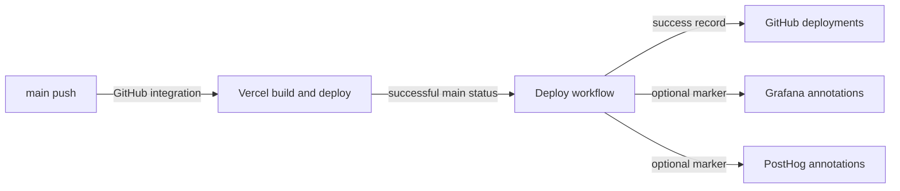

# Deployment

Vercel's GitHub integration builds and hosts the application. The repository's Deploy workflow records successful production deploys and annotations; it is not the deployment engine (`README.md`, `.github/workflows/deploy.yml`).

## Application deployment

The documented integration deploys `main` to production and PRs to previews. `npm run build` creates the production build, and `npm run start` serves it locally (`package.json`, `docs/architecture.md`).

`.github/workflows/deploy.yml` listens for a successful commit status whose context is `Vercel` and whose branch list includes `main`. It:

1. Creates a GitHub deployment and success status.
2. Adds a Grafana annotation when Grafana configuration is available.
3. Adds a PostHog project annotation when configured; this step is allowed to fail without hiding the deployment record.

`PRODUCTION_URL` can supply the user-facing deployment URL; otherwise the status target URL is used. See [configuration](reference/configuration.md).

## Runtime telemetry packaging

`next.config.mjs` enables the instrumentation hook and keeps the native profiler packages outside webpack. Explicit output-file tracing includes their Linux native binary and runtime support files, which static import tracing alone may miss.

`instrumentation.ts` loads Node telemetry only for the Node runtime. `server/instrumentation-node.ts` makes profiling optional and catches startup failures. A successful build alone does not prove that a deployed native profiler can load.

Set telemetry variables in the appropriate Vercel environments, not in committed files. Browser `NEXT_PUBLIC_*` values are bundled into the client; server exporter credentials must not be public. See [security boundaries](security.md) and [tracing](how-to-monitor/tracing.md).

## Releases and rollback

`.github/workflows/release.yml` reacts to tags matching `v*`, installs dependencies, runs unit tests and a production build, then creates a GitHub release with generated notes. It does not itself deploy to Vercel.

For a regression tied to a deploy marker, `docs/runbooks/observability.md` directs operators to Vercel Instant Rollback, followed by a fix-forward branch. Compare the affected release tags, logs, and metrics before deciding what to roll back.

## Dashboard and wiki publication

`.github/workflows/observability.yml` provisions `observability/grafana/dashboard.json` and `observability/grafana/alert-rules.json` through `scripts/grafana-sync.mjs` when relevant files change on `main`, or manually. This is an authenticated external write, not a local validation command.

The documentation pipeline in `.github/workflows/droid-wiki-refresh.yml` runs on every push to `main`. There is no path exclusion, so merging generated pages also triggers a refresh:

| Stage | Behavior |
| --- | --- |
| Restore | Fetch `factory/droid-wiki` and restore only `droid-wiki/`; first run can generate from scratch |
| Generate | Use full history and run `/wiki` in a repository-read-only job |
| Transfer | Upload Markdown and hidden metadata as a one-day artifact; exclude video and images |
| Publish | Separate job with repository/PR writes opens or updates one rolling PR against the default branch for review and merge |

The fixed concurrency group queues refreshes rather than canceling the current one. `FACTORY_WIKI_PR_TOKEN` can provide scoped write access; fallback `GITHUB_TOKEN` PRs do not trigger other workflows. A publish failure becomes a warning rather than erasing the already-generated wiki. Source files in the restored wiki remain input, not permission to grant generation a write token.

The workflow does not request auto-merge or run `gh pr merge`. Review and merge the rolling PR separately, following the repository's branch rules. The fallback token can leave required checks waiting because its PRs do not trigger workflows.

See [tooling](how-to-contribute/tooling.md) for checks and [alerting](how-to-monitor/alerting.md) for operational scripts.
