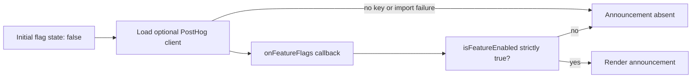

# Analytics and flags
Active contributors: **nicolasschmidt2001**.

## Purpose

Optional PostHog integration observes the shopping journey, reports browser exceptions, and controls one menu announcement. The storefront must remain usable without a project key or enabled flags. Pure naming/property helpers live in `lib/analytics.ts`; browser SDK loading and React flag state live in `components/posthog.ts`.

## Event and property contract

`ANALYTICS_EVENTS` defines the allowed `AnalyticsEvent` string union. `AnalyticsProperties` permits string, number, and boolean values, but is a generic record: TypeScript does **not** enforce a separate property schema for each event. Use the existing builders rather than assembling sensitive ad hoc payloads.

| Event | Call site | Custom properties |
| --- | --- | --- |
| `product_added` | `components/ProductCard.tsx` | `productId`, category, unit `priceCents`, resulting `quantityInCart`. |
| `cart_opened` | `components/CartProvider.tsx` | `lineCount`, summed `itemCount`, priced `totalCents`. |
| `checkout_started` | `components/Checkout.tsx` | Same cart summary; tracked once per component mount after hydration with a nonempty cart. |
| `order_placed` | `components/Checkout.tsx` | `orderId`, pickup, line/item counts, server `totalCents`. |
| `order_failed` | `components/Checkout.tsx` | `errorCount`, not raw submitted input or customer name. |

`releaseProperties` adds `appRepo`, `appVersion` (first seven commit characters), and `appEnvironment`. Browser initialization reads public Vercel repository/SHA/environment variables; missing values become `local`, `dev`, and `development`. `server/release.ts` uses the same helper with server Vercel variables for server exceptions.

## Lazy loading and configuration

`components/Analytics.tsx` renders nothing and calls `loadAnalytics` after first render. `track` and `captureError` also call the loader, so callers need not wait for bootstrap.

Without `NEXT_PUBLIC_POSTHOG_KEY`, or outside a browser, the loader resolves to null without importing the SDK. Otherwise it caches a single dynamic-import promise, initializes PostHog, registers release properties, and reuses the client. Import rejection resolves to null. Event sending is fire-and-forget, not a delivery guarantee.

`NEXT_PUBLIC_POSTHOG_HOST` defaults to `https://us.i.posthog.com`. Configuration uses defaults `2025-05-24`, `person_profiles: identified_only`, automatic exception capture, and disabled session recording. Same-host tracing headers let server errors correlate to browser session/distinct IDs. See [configuration](../reference/configuration.md) and [tracing](../how-to-monitor/tracing.md) for server integration.

## Flag lifecycle

`FEATURE_FLAGS.menuAnnouncement` maps to `menu-announcement`, the only current flag. `useFeatureFlag` starts false, subscribes after the client loads, and removes the subscription on cleanup. An active guard prevents subscribing after unmount. `components/MenuAnnouncement.tsx` displays “Cardamom buns are back, baked fresh every morning.” only when enabled; it does not gate ordering.

## Privacy, tests, and modification entrypoints

Never put the customer's name or other personal data into custom properties. `orderProperties` deliberately omits the name; `tests/analytics.test.ts` checks this alongside names, release fallbacks, product details, and cart totals. These are pure Node tests, not SDK delivery, subscription-lifecycle, or browser privacy tests. Disabled session recording is not a blanket guarantee that every automatically captured signal is free of sensitive data.

Add event/flag keys and pure property builders in `lib/analytics.ts`, invoke `track` at the interaction boundary, and test property shape and PII exclusion. Keep each new flag's disabled path functional. Route errors through the existing exception wrappers rather than adding SDK initialization to `lib/`. Server log redaction matches sensitive keys and does not automatically scrub customer names in arbitrary text; see [security boundaries](../security.md) and [logging](../how-to-monitor/logging.md).

## Key source files

| Repository path | Responsibility |
| --- | --- |
| `lib/analytics.ts` | Typed names, scalar properties, release and commerce builders. |
| `components/posthog.ts` | Cached loading, capture wrappers, configuration, and flag hook. |
| `components/Analytics.tsx` | Renderless bootstrap mounted by `app/layout.tsx`. |
| `components/MenuAnnouncement.tsx` | Current flag consumer. |
| `tests/analytics.test.ts` | Pure contract and privacy assertions. |

## Scoped maintenance snapshot

At `origin/main` `902a299`: **4 source files** (the first four table rows), **1 test file**, **1/4 = 0.25 test-file/source-file ratio**. Event call sites, shared layout, and server telemetry are integrations excluded from this scope. This is not coverage. Unique-human bus-factor proxy: **1**, derived from `.github/CODEOWNERS` plus scoped default-branch log/blame, normalizing Nicolas Schmidt aliases to nicolasschmidt2001 and excluding bots.
