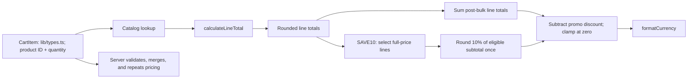

# Cart and pricing
Active contributors: **nicolasschmidt2001**.

## Purpose

The cart shares quantities and a promo code across pages, restores them after a reload, and calculates checkout totals with per-line bulk pricing followed by SAVE10 on full-price lines. React and browser storage live in `components/`; quantity and pricing functions stay pure in `lib/`.

## State, hydration, and drawer

`useCart` in `components/CartProvider.tsx`, mounted in `app/layout.tsx`, exposes items, raw promo text and its setter, total item count, loading/open state, quantity actions, and clear/open/close actions.

The initial cart is empty until an effect reads localStorage keys `bean-and-byte:cart` (JSON items) and `bean-and-byte:promo` (raw string, preserving case and spaces). A separate persistence effect writes both only after `isLoaded` becomes true, preventing the initial empty state from overwriting saved values. `clear` resets items and promo text; successful checkout calls it. Persistence then writes `[]` and an empty string rather than removing the keys. This is browser-local persistence, not account synchronization.

`parseStoredCart` in `lib/cart.ts` handles missing or malformed JSON and filters entries to known products with positive integer quantities. It does **not** deduplicate products or impose a 99-quantity cap. The provider's storage reads and writes are not wrapped in the best-effort exception handling used by last-order storage.

`addItem` delegates to `changeQuantity` in `lib/cart.ts`; updates return new arrays and changed line objects. Lines at zero or below disappear. These helpers assume trusted callers rather than being general input validators. `countItems` in the same file sums quantities, not distinct lines.

`components/CartDrawer.tsx` renders a modal-labelled side panel, quantity controls, bulk-priced line totals, a separate positive promo-discount row, and a checkout link. `PromoCodeField` in `components/PromoCodeField.tsx` is shared by the drawer and checkout: input changes apply immediately, clearing removes the code, and an associated live `role="status"` message explains valid/invalid states with `aria-invalid` on unknown codes. An unknown code leaves the preview at its no-promo total, but the API rejects it until cleared or corrected. The drawer focuses the close button on opening and closes on Escape or overlay click; this is not a claim of a full focus trap.

## Pricing flow and examples

`calculateLineTotal` in `lib/pricing.ts` uses threshold **3** and discount rate **0.1**. For a positive quantity, gross cents are `priceCents * quantity`; qualifying lines return `Math.round(gross * (1 - BULK_DISCOUNT_RATE))`. The bulk calculation uses fractional arithmetic internally, while normal catalog/validated quantities produce whole-cent outputs. It rounds once per line, not per unit or once for the entire cart.

| Cart | Without code | With SAVE10 |
| --- | ---: | ---: |
| 2 Drip Coffees | $7.00 | $6.30 |
| 3 Drip Coffees | $9.45, versus $10.50 gross | $9.45 |
| 3 Drip Coffees + 1 Espresso | $12.40 | $12.10 |
| 3 Espressos | $7.97, rounding 796.5 cents | $7.97 |
| 1 Espresso | $2.95 | $2.65 |
| 2 Espressos | $5.90 | $5.31 |

`priceLines` in `lib/pricing.ts` skips nonpositive quantities and unknown products but does not merge duplicate IDs or fully validate quantities. Server order validation handles that boundary; duplicate stored lines can therefore be priced differently before server merging. See [checkout](checkout.md).

## Promotions and modification entrypoints

`calculateCartTotal(items, promoCode?)` in `lib/pricing.ts` subtracts a recognized promotion's discount after bulk pricing and clamps the total to zero. The `Promotion` contract in `lib/promotions.ts` receives **all** post-bulk `PricedLine[]` values from `lib/types.ts`. SAVE10 itself enforces FIN-212: keep only lines where `lineTotalCents === catalogPriceCents * quantity`, excluding bulk-priced lines. This is not a universal filter protecting future registry entries.

`findPromotion` in `lib/promotions.ts` trims and uppercases input; `PROMOTIONS` contains SAVE10, “10% off full-price items.” It sums the eligible subtotal and rounds the 10% discount **once per order**, using integer quotient/remainder arithmetic: `floor(subtotalCents / 10)` plus one cent when `subtotalCents % 10 >= 5`. Thus 295 eligible cents yield a 30-cent discount; 590 yield 59 cents, not 60. See the [glossary](../overview/glossary.md) for full-price lines, bulk-priced lines, and FIN-212.

Both UI surfaces pass promo text into shared pricing. `lib/orders.ts` validates optional codes and normalizes accepted ones before authoritative repricing; unknown codes are ignored by the preview but rejected by checkout's API. See the [API contract](../api.md) and [analytics](analytics.md).

Change arithmetic in `lib/pricing.ts` and preserve server/client reuse; future codes belong in `lib/promotions.ts` with explicit eligibility and rounding rules. Update literal discount labels in UI if changing the rate. `tests/pricing.test.ts` covers bulk thresholds, catalog-wide non-stacking for current promotions, mixed carts, skipped/empty lines, code normalization, rounding, and currency formatting. `tests/promotions.test.ts` isolates SAVE10 eligibility and once-per-order rounding across multiple eligible products. Quantity and storage parser tests belong in `tests/cart.test.ts`. The nine scenarios in `e2e/storefront.spec.ts` cover the original shopping/health flow plus promo persistence, quantity-boundary updates, clearing after checkout, confirmed discounts, and invalid-code/API handling. They do not exhaust storage failures or duplicate stored-line behavior.

## Key source files

| Repository path | Responsibility |
| --- | --- |
| `lib/cart.ts` | Immutable quantity helpers and stored-cart parsing. |
| `lib/pricing.ts` | Per-line bulk pricing, cart summation, and promotion orchestration. |
| `lib/promotions.ts` | SAVE10 eligibility, integer rounding, and normalized lookup. |
| `lib/currency.ts` | USD display formatting. |
| `components/CartProvider.tsx` | Shared state and localStorage lifecycle. |
| `components/CartDrawer.tsx` | Quantity controls and price display. |
| `components/PromoCodeField.tsx` | Shared accessible promo input and immediate feedback. |
| `tests/cart.test.ts`, `tests/pricing.test.ts`, `tests/promotions.test.ts`, `e2e/storefront.spec.ts` | Unit and shared browser scenarios. |

## Scoped maintenance snapshot

At `origin/main` [`e0462e9`](https://github.com/FactoryDemo/demo-storefront-practice/commit/e0462e94b0cfa8c89bd419994343526e3800fc53): **7 source files** (the first seven table rows), **4 test files**, **4/7 = 0.57 test-file/source-file ratio**, excluding imported shared dependencies. This measures files, not coverage. Unique-human bus-factor proxy: **1**, derived from `.github/CODEOWNERS` plus scoped default-branch log/blame; Nicolas Schmidt's email aliases collapse to nicolasschmidt2001, excluding bots.

For storage and priced-line shapes, see [data models](../reference/data-models.md).
