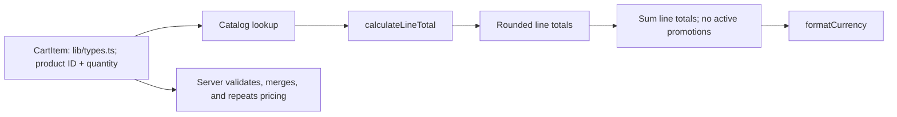

# Cart and pricing
Active contributors: **nicolasschmidt2001**.

## Purpose

The cart shares item quantities across pages, restores them after a reload, and calculates totals with per-line bulk pricing. React and browser storage live in `components/`; quantity and pricing functions stay pure in `lib/`. The promotion hook remains dormant with an empty registry and no entry UI.

## State, hydration, and drawer

`useCart` in `components/CartProvider.tsx`, mounted in `app/layout.tsx`, exposes `items`, `itemCount`, `isLoaded`, `isOpen`, and add/change/clear/open/close actions. There is no promo state or apply/remove-code action.

The initial cart is empty until an effect reads localStorage key `bean-and-byte:cart` (JSON items). The persistence effect waits for `isLoaded`, preventing initial empty state from overwriting saved values. `clear` empties items; successful checkout calls it, and persistence then writes `[]`. The provider neither reads nor writes/removes the old `bean-and-byte:promo` key, so an old value can remain inert. This is browser-local persistence, not account synchronization.

`parseStoredCart` in `lib/cart.ts` handles missing or malformed JSON and filters entries to known products with positive integer quantities. It does **not** deduplicate products or impose a 99-quantity cap. The provider's storage reads and writes are not wrapped in the best-effort exception handling used by last-order storage.

`addItem` delegates to `changeQuantity` in `lib/cart.ts`; updates return new arrays and changed line objects. Lines at zero or below disappear. These helpers assume trusted callers rather than being general input validators. `countItems` in the same file sums quantities, not distinct lines.

`components/CartDrawer.tsx` renders a modal-labelled side panel, quantity controls, bulk-priced line totals, a bulk-only cart total, and a checkout link. Empty carts show an empty message instead of the footer. There is no promo field or order-discount row. The drawer focuses the close button on opening and closes on Escape or overlay click; this is not a claim of a full focus trap.

## Pricing flow and examples

`calculateLineTotal` in `lib/pricing.ts` uses threshold **3** and discount rate **0.1**. For a positive quantity, gross cents are `priceCents * quantity`; qualifying lines return `Math.round(gross * (1 - BULK_DISCOUNT_RATE))`. The bulk calculation uses fractional arithmetic internally, while normal catalog/validated quantities produce whole-cent outputs. It rounds once per line, not per unit or once for the entire cart.

| Cart | Current total |
| --- | ---: |
| 2 Drip Coffees | $7.00 |
| 3 Drip Coffees | $9.45, versus $10.50 gross |
| 3 Drip Coffees + 1 Espresso | $12.40 |
| 2 Lattes | $9.50 |
| 3 Espressos | $7.97, rounding 796.5 cents |
| 1 Espresso | $2.95 |
| 2 Espressos | $5.90 |

`priceLines` in `lib/pricing.ts` skips nonpositive quantities and unknown products but does not merge duplicate IDs or fully validate quantities. Server order validation handles that boundary; duplicate stored lines can therefore be priced differently before server merging. See [checkout](checkout.md).

## Promotions and modification entrypoints

`calculateCartTotal(items, promoCode?)` in `lib/pricing.ts` sums post-bulk line totals. If a code resolves to a registered promotion, it passes **all** post-bulk `PricedLine[]` values from `lib/types.ts` to the callback, subtracts its discount, and clamps the final total to zero. There is no bulk-line exclusion or non-stacking filter in the dispatcher.

`findPromotion` in `lib/promotions.ts` trims and uppercases input, but `PROMOTIONS` is empty. SAVE10 is not live, and any supplied code currently leaves the helper total unchanged. The `Promotion` type describes a code, description, and `discountCents` callback; it does not define a built-in percentage or rounding rule for future codes. See the [glossary](../overview/glossary.md) for promotion and bulk terminology.

The drawer, checkout, server order builder, and analytics cart summaries all price items only. `lib/orders.ts` ignores extra request fields, including `promoCode`, and returns no applied-code field. There is no current promotional UI/analytics discrepancy. See [checkout](checkout.md), the [API contract](../api.md), [analytics](analytics.md), and [security boundaries](../security.md).

Change arithmetic in `lib/pricing.ts` and preserve server/client reuse; future codes belong in `lib/promotions.ts` with explicit eligibility and rounding rules, plus UI/API wiring if needed. Update literal discount labels in UI if changing the rate. `tests/pricing.test.ts` covers bulk thresholds and larger quantities, nonpositive quantities, mixed carts, skipped/empty lines, unknown codes, and currency formatting. It has no dedicated bulk half-cent assertion, registered-promotion callback/clamp coverage, or standalone promotions test module. Quantity and storage parser tests belong in `tests/cart.test.ts`. The six scenarios in `e2e/storefront.spec.ts` cover menu rendering, the three-item discount, cart reload persistence, checkout/confirmation and cart clearing, order API repricing/rejection, and health. They do not exhaust storage failures, stale promo-key behavior, or duplicate stored-line behavior. See [testing](../how-to-contribute/testing.md) for the current suite.

## Key source files

| Repository path | Responsibility |
| --- | --- |
| `lib/cart.ts` | Immutable quantity helpers and stored-cart parsing. |
| `lib/pricing.ts` | Per-line bulk pricing, cart summation, and promotion orchestration. |
| `lib/promotions.ts` | Empty registry, promotion contract, and normalized lookup. |
| `lib/currency.ts` | USD display formatting. |
| `components/CartProvider.tsx` | Shared state and localStorage lifecycle. |
| `components/CartDrawer.tsx` | Quantity controls and price display. |
| `tests/cart.test.ts`, `tests/pricing.test.ts`, `e2e/storefront.spec.ts` | Unit and shared browser scenarios. |

## Scoped maintenance snapshot

At `origin/main` [`8a42447`](https://github.com/FactoryDemo/demo-storefront-practice/commit/8a424472be94bba50c1d2458190cf3461cf30d41): **6 source files** (the first six table rows), **3 test files**, **3/6 = 0.50 test-file/source-file ratio**, rechecked against the listed paths and excluding imported shared dependencies. This measures files, not coverage. Unique-human bus-factor proxy: **1**, derived from `.github/CODEOWNERS` plus scoped `git log origin/main`; Nicolas Schmidt/nicolasschmidt2001 and email aliases collapse to nicolasschmidt2001, excluding bots.

For storage and priced-line shapes, see [data models](../reference/data-models.md).
