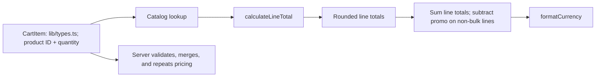

# Cart and pricing
Active contributors: **nicolasschmidt2001**.

## Purpose

The cart shares item quantities and an applied promo code across pages, restores them after a reload, and calculates totals with per-line bulk pricing plus non-stacking SAVE10. React and browser storage live in `components/`; quantity and pricing functions stay pure in `lib/`.

## State, hydration, and drawer

`useCart` in `components/CartProvider.tsx`, mounted in `app/layout.tsx`, exposes items, total item count, loading/open state, quantity actions, clear/open/close actions, and `promoCode`, `applyPromoCode`, and `removePromoCode`. Applying a valid code stores its canonical uppercase value and returns true; invalid application clears the code and returns false.

The initial cart is empty until an effect reads localStorage key `bean-and-byte:cart` (JSON items) and `bean-and-byte:promo` (raw code text). A saved code is accepted only if `findPromotion` recognizes it, but restoration preserves the saved text rather than normalizing it. Separate persistence effects wait for `isLoaded`, preventing initial empty state from overwriting saved values. `clear` resets items and the code; successful checkout calls it. Persistence then writes `[]` for items and removes the promo key. This is browser-local persistence, not account synchronization.

`parseStoredCart` in `lib/cart.ts` handles missing or malformed JSON and filters entries to known products with positive integer quantities. It does **not** deduplicate products or impose a 99-quantity cap. The provider's storage reads and writes are not wrapped in the best-effort exception handling used by last-order storage.

`addItem` delegates to `changeQuantity` in `lib/cart.ts`; updates return new arrays and changed line objects. Lines at zero or below disappear. These helpers assume trusted callers rather than being general input validators. `countItems` in the same file sums quantities, not distinct lines.

`components/CartDrawer.tsx` renders a modal-labelled side panel, quantity controls, bulk-priced line totals, a promo-aware cart total, and a checkout link. Its inline `PromoCodeField` appears only for a nonempty cart: Apply is disabled for trimmed-empty input, invalid codes produce a `role="alert"` message, and an applied code has a Remove action. There is no separate component file or order-discount row. The drawer focuses the close button on opening and closes on Escape or overlay click; this is not a claim of a full focus trap.

## Pricing flow and examples

`calculateLineTotal` in `lib/pricing.ts` uses threshold **3** and discount rate **0.1**. For a positive quantity, gross cents are `priceCents * quantity`; qualifying lines return `Math.round(gross * (1 - BULK_DISCOUNT_RATE))`. The bulk calculation uses fractional arithmetic internally, while normal catalog/validated quantities produce whole-cent outputs. It rounds once per line, not per unit or once for the entire cart.

| Cart | Current total |
| --- | ---: |
| 2 Drip Coffees | $7.00 |
| 3 Drip Coffees | $9.45, versus $10.50 gross |
| 3 Drip Coffees + 1 Espresso | $12.40 |
| 3 Drip Coffees + 1 Espresso, SAVE10 | $12.10: only Espresso is promo-eligible |
| 3 Drip Coffees, SAVE10 | $9.45: no stacking with bulk pricing |
| 2 Lattes, SAVE10 | $8.55, versus $9.50 without a code |
| 3 Espressos | $7.97, rounding 796.5 cents |
| 1 Espresso | $2.95 |
| 2 Espressos | $5.90 |

`priceLines` in `lib/pricing.ts` skips nonpositive quantities and unknown products but does not merge duplicate IDs or fully validate quantities. Server order validation handles that boundary; duplicate stored lines can therefore be priced differently before server merging. See [checkout](checkout.md).

## Promotions and modification entrypoints

`calculateCartTotal(items, promoCode?)` in `lib/pricing.ts` sums post-bulk line totals, then filters to quantities below `BULK_DISCOUNT_THRESHOLD` **before** invoking the promotion callback (FIN-212). The `Promotion` contract in `lib/promotions.ts` therefore receives only eligible `PricedLine[]` values from `lib/types.ts`. The dispatcher subtracts the returned discount and clamps the final total to zero; bulk lines never receive a promo discount.

`findPromotion` in `lib/promotions.ts` trims and uppercases input. `PROMOTIONS` registers SAVE10, whose callback rounds 10% of the **combined eligible subtotal once**, not each eligible line independently. In the mixed Drip/Espresso example, 10% of 295 cents rounds to a 30-cent discount. Unknown helper codes leave the total unchanged. See the [glossary](../overview/glossary.md) for promotion and bulk terminology.

The drawer and checkout pass the applied code to pricing. `lib/orders.ts` validates and normalizes an optional request code, re-prices with it, and returns it on the order. Analytics cart summaries still pass items only, so promo-priced UI and final order totals can differ from `cart_opened` and `checkout_started`. See [checkout](checkout.md), the [API contract](../api.md), [analytics](analytics.md), and [security boundaries](../security.md).

Change arithmetic in `lib/pricing.ts` and preserve server/client reuse; future codes belong in `lib/promotions.ts` with explicit eligibility and rounding rules. Update literal discount labels in UI if changing the rate. `tests/pricing.test.ts` covers bulk thresholds and larger quantities, nonpositive quantities, mixed carts, skipped/empty lines, unknown codes, currency formatting, SAVE10 normalization, mixed-cart half-cent promo rounding, non-stacking, and empty/all-bulk promo carts. It has no dedicated bulk half-cent assertion or standalone promotions test module. Quantity and storage parser tests belong in `tests/cart.test.ts`. The six unchanged scenarios in `e2e/storefront.spec.ts` cover menu rendering, the three-item discount, cart reload persistence, checkout/confirmation and cart clearing, order API repricing/rejection, and health. They do not exercise promo entry/persistence or exhaust storage failures and duplicate stored-line behavior. See [testing](../how-to-contribute/testing.md) for the current suite.

## Key source files

| Repository path | Responsibility |
| --- | --- |
| `lib/cart.ts` | Immutable quantity helpers and stored-cart parsing. |
| `lib/pricing.ts` | Per-line bulk pricing, cart summation, and promotion orchestration. |
| `lib/promotions.ts` | SAVE10 callback, promotion contract, and normalized lookup. |
| `lib/currency.ts` | USD display formatting. |
| `components/CartProvider.tsx` | Shared state and localStorage lifecycle. |
| `components/CartDrawer.tsx` | Quantity controls and price display. |
| `tests/cart.test.ts`, `tests/pricing.test.ts`, `e2e/storefront.spec.ts` | Unit and shared browser scenarios. |

## Scoped maintenance snapshot

At `origin/main` [`05be85e`](https://github.com/FactoryDemo/demo-storefront-practice/commit/05be85e2a6da3930a48c3b3a6ebc53d2e2567b40): **6 source files** (the first six table rows), **3 test files**, **3/6 = 0.50 test-file/source-file ratio**, excluding imported shared dependencies. This measures files, not coverage. Unique-human bus-factor proxy: **1**, derived from `.github/CODEOWNERS` plus scoped `git log origin/main`; Nicolas Schmidt/nicolasschmidt2001 and email aliases collapse to nicolasschmidt2001, excluding bots.

For storage and priced-line shapes, see [data models](../reference/data-models.md).
