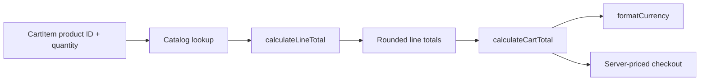

# Cart and pricing
Active contributors: **nicolasschmidt2001**.

## Purpose

The cart shares quantities across pages, restores them after a reload, and calculates the same per-line bulk prices used by checkout. React and browser storage live in `components/`; quantity and pricing functions stay pure in `lib/`.

## State, hydration, and drawer

`components/CartProvider.tsx`, mounted in `app/layout.tsx`, exposes items, total item count, loading/open state, quantity actions, and clear/open/close actions through `useCart`.

The initial cart is empty until an effect reads `localStorage` key `bean-and-byte:cart`. A separate persistence effect writes only after `isLoaded` becomes true, preventing the initial empty state from overwriting saved quantities. This is browser-local persistence, not account synchronization.

`parseStoredCart` in `lib/cart.ts` handles missing or malformed JSON and filters entries to known products with positive integer quantities. It does **not** deduplicate products or impose a 99-quantity cap. The provider's storage reads and writes are not wrapped in the best-effort exception handling used by last-order storage.

`addItem` delegates to `changeQuantity`; updates return new arrays and changed line objects. Lines at zero or below disappear. These helpers assume trusted callers rather than being general input validators. `countItems` sums quantities, not distinct lines.

`components/CartDrawer.tsx` renders a modal-labelled side panel, quantity controls, discounted line totals, and a checkout link. It focuses the close button on opening and closes on Escape or overlay click; this is not a claim of a full focus trap.

## Pricing flow and examples

`lib/pricing.ts` defines threshold **3** and discount rate **0.1**. For a positive quantity, gross cents are `priceCents * quantity`; qualifying lines return `Math.round(gross * (1 - BULK_DISCOUNT_RATE))`. The calculation uses fractional arithmetic internally, while normal catalog/validated quantities produce whole-cent outputs. It rounds once per line, not per unit or once for the entire cart.

| Cart | Total |
| --- | ---: |
| 2 Drip Coffees | $7.00 |
| 3 Drip Coffees | $9.45, versus $10.50 gross |
| 3 Drip Coffees + 1 Espresso | $12.40 |
| 3 Espressos | $7.97, rounding 796.5 cents |

`priceLines` skips nonpositive quantities and unknown products but does not merge duplicate IDs or fully validate quantities. Server order validation handles that boundary; duplicate stored lines can therefore be priced differently before server merging. See [checkout](checkout.md).

## Dormant promotions and modification entrypoints

`calculateCartTotal(items, promoCode?)` optionally subtracts a promotion's discount after bulk pricing and clamps the result to zero. `findPromotion` trims and uppercases input, but `PROMOTIONS` in `lib/promotions.ts` is empty. **There are no active codes, checkout code input, or API promotion support.**

Change arithmetic in `lib/pricing.ts` and preserve server/client reuse. Update literal discount labels in UI if changing the rate. Add threshold, fractional-cent rounding, mixed-cart, and invalid-input tests in `tests/pricing.test.ts`; quantity and storage parser tests belong in `tests/cart.test.ts`. Existing browser tests cover a discounted cart, reload persistence, and checkout; they do not exhaust storage failures or duplicate-line behavior.

## Key source files

| Repository path | Responsibility |
| --- | --- |
| `lib/cart.ts` | Immutable quantity helpers and stored-cart parsing. |
| `lib/pricing.ts` | Per-line pricing, cart summation, and optional promotion hook. |
| `lib/promotions.ts` | Empty registry and normalized lookup. |
| `lib/currency.ts` | USD display formatting. |
| `components/CartProvider.tsx` | Shared state and localStorage lifecycle. |
| `components/CartDrawer.tsx` | Quantity controls and price display. |
| `tests/cart.test.ts`, `tests/pricing.test.ts`, `e2e/storefront.spec.ts` | Unit and shared browser scenarios. |

## Scoped maintenance snapshot

At `origin/main` `902a299`: **6 source files** (the first six table rows), **3 test files**, **3/6 = 0.50 test-file/source-file ratio**, excluding imported shared dependencies. This measures files, not coverage. Unique-human bus-factor proxy: **1**, derived from `.github/CODEOWNERS` plus scoped default-branch log/blame; Nicolas Schmidt's email aliases collapse to nicolasschmidt2001, excluding bots.

For storage and priced-line shapes, see [data models](../reference/data-models.md).
