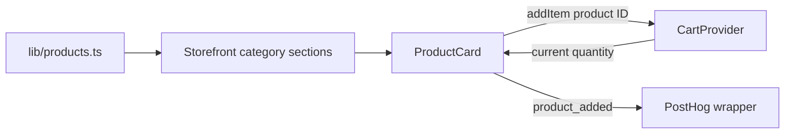

# Catalog
Active contributors: **nicolasschmidt2001**.

## Purpose

The menu presents 13 static products across four categories and lets customers add them to the shared cart. There is no catalog API, inventory service, or administrative editor: `lib/products.ts` is the catalog used by both UI and server order validation.

## Layout and key abstractions

`ProductCategory` in `lib/types.ts` is the union `hot | cold | beans | bakery`. `Category` supplies section text; `Product` supplies a kebab-case ID, name, description, category, integer-cent price, and public photo path.

`CATEGORIES` in `lib/products.ts` determines navigation and section order:

| Category ID | Display name | Products |
| --- | --- | ---: |
| `hot` | Hot coffee | 4 |
| `cold` | Cold | 3 |
| `beans` | Beans | 3 |
| `bakery` | Bakery | 3 |

`app/page.tsx` renders `components/Storefront.tsx`, which builds a hero, anchor-based category navigation, and one product grid per category. `productsInCategory` filters the static array. The hero uses the latte photograph and imports the quantity threshold from `lib/pricing.ts`; its “10% off” wording is literal UI copy.

`components/ProductCard.tsx` is the client interaction boundary. It formats the unit price with `lib/currency.ts`, reads the current quantity with `useCart`, and displays an “in cart” count after additions. Photos use Next.js `Image` with responsive sizes; product image URLs point into `public/products/`.

## Add-to-cart flow and integrations

An addition carries only the product ID into cart state. Catalog prices are looked up later by the [pricing core](cart-pricing.md), not copied into each cart entry. The card also emits `product_added` using `productAddedProperties`, including the newly requested quantity; see [analytics](analytics.md). A flag-controlled announcement sits above the hero but is not required for the menu.

`getProduct` throws for an unknown ID. Its lookup returns the catalog object itself, while category filtering returns a new array containing the same product objects. Treat these exported records as shared data rather than mutating them at runtime.

## Modification entrypoints

Add or change products in `lib/products.ts`, retaining positive whole-cent prices and unique IDs. Place the corresponding JPEG under `public/products/`; the current 13 photos follow `/products/<product-id>.jpg`. A new category also needs the `ProductCategory` union and `CATEGORIES` updated. Card rendering changes belong in `components/ProductCard.tsx`; category layout belongs in `components/Storefront.tsx`.

`tests/products.test.ts` checks IDs, prices, image-path strings, categories, and lookup failures. It does not verify that the photo files exist or visually inspect them. `e2e/storefront.spec.ts` checks category headings, displayed menu content, and additions through the broader shopping flow.

## Key source files

| Repository path | Responsibility |
| --- | --- |
| `app/page.tsx` | Home route entrypoint. |
| `lib/types.ts` | Catalog and shared cart types. |
| `lib/products.ts` | Categories, products, and lookup helpers. |
| `components/Storefront.tsx` | Hero, navigation, and category grids. |
| `components/ProductCard.tsx` | Photos, prices, quantity feedback, and add action. |
| `public/products/` | 13 JPEG assets, excluded from code-file metrics. |
| `tests/products.test.ts`, `e2e/storefront.spec.ts` | Catalog invariants and shared browser scenarios. |

## Scoped maintenance snapshot

At `origin/main` `902a299`: **5 source files** (the first five table rows), **2 test files**, **2/5 = 0.40 test-file/source-file ratio**. Shared dependencies and assets are excluded; this is not a coverage percentage.

Unique-human bus-factor proxy: **1**. `.github/CODEOWNERS` names nicolasschmidt2001; scoped `git log origin/main` and `git blame origin/main` identify Nicolas Schmidt, normalized to that account across email aliases. Bots are excluded.
