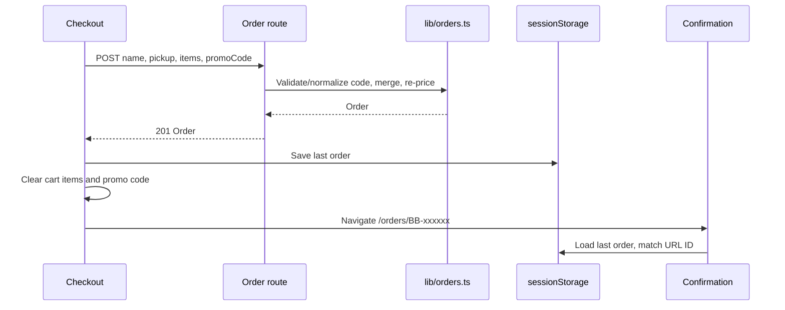

# Pickup checkout
Active contributors: **nicolasschmidt2001**.

## Purpose

Checkout turns the browser cart and optional SAVE10 code into a server-priced mock pickup order. It collects a name and relative pickup choice, not payment details. There is no database, fulfillment integration, account, or persisted order history.

## Request and authoritative validation

`app/checkout/page.tsx` renders `components/Checkout.tsx`. Checkout waits for cart hydration, shows an empty-cart alternative when needed, and otherwise displays a form beside `components/OrderLines.tsx`.

The browser submits `{ name, pickup, items, promoCode }` to `POST /api/orders`; no displayed total is sent as authority. The `OrderRequest` type in `lib/orders.ts` makes `promoCode` optional for other callers. `app/api/orders/route.ts` calls `validateOrderRequest` in `lib/orders.ts`, which gathers errors across fields:

- Name must be a string with 1–60 characters after trimming.
- Pickup must be `asap`, `in-15`, `in-30`, `in-45`, or `in-60`.
- Items must be a nonempty array of known product IDs.
- **Each submitted item** must have an integer quantity from 1 through 99.
- Promo code may be omitted or a blank string (normalized to absence). A recognized string is trimmed and uppercased; `null`, nonstrings, and unknown codes are rejected with “Enter a valid promo code or remove it.”

Unrecognized extra fields, including client totals, are ignored. `PromoCodeField` in `components/PromoCodeField.tsx` shares raw promo state between the drawer and checkout and provides accessible live feedback. Unknown codes leave the preview at its no-promo total but still reach server validation if submitted; a warning is not a client-side submission block.

Only after all validation succeeds does `mergeItems` in `lib/orders.ts` combine repeated product IDs. The 99 limit is **not** reapplied to the merged line: two entries of 99 become a valid merged quantity of 198. Merging also means separate entries of one and two Drip Coffees qualify for the three-item bulk discount when server-priced.

`buildOrder` in `lib/orders.ts` calls shared `priceLines` and `calculateCartTotal` in `lib/pricing.ts`, using catalog prices rather than client prices and forwarding the canonical recognized code. Three Drip Coffees plus one Espresso total $12.40 without a code or $12.10 with SAVE10; line amounts remain $9.45 and $2.95, with a separate 30-cent order discount. SAVE10 excludes bulk-priced lines (FIN-212), so three Espressos remain $7.97 even after code validation. See [cart and pricing](cart-pricing.md) for eligibility and rounding.

The route generates `BB-` plus the first six uppercase UUID characters and a current timestamp, then returns the order with HTTP 201. Invalid JSON and rejected fields produce HTTP 400 with an `errors` array. `withTelemetry` in `server/telemetry.ts` converts unexpected exceptions to a generic reported HTTP 500; see the [API reference](../api.md).

## Submission, failure, and confirmation flow

The form disables submission while pending. Rejections display server error messages, emit `order_failed` with an error count, and re-enable submission. Fetch or JSON-decoding failures use a connection/retry message. Successful responses are cast to `Order` from `lib/orders.ts`, not runtime schema-validated in the browser.

The summary and submit-button total use shared bulk-plus-promo pricing. `OrderLines` in `components/OrderLines.tsx` computes the displayed promo discount as the sum of post-bulk line totals minus the final total, rendering a row only when a code exists and the difference is positive. Confirmation receives the server's canonical code and priced amounts, not the current cart state. Cart persistence and hydration belong to `components/CartProvider.tsx`; see [data models](../reference/data-models.md).

On success, checkout emits `order_placed` with the authoritative final total, saves the response, clears cart items and promo text, and navigates to `app/orders/[id]/page.tsx`. `checkout_started` reports the current promo-adjusted cart total once per mount; see [analytics](analytics.md). `components/lastOrder.ts` stores only one value under sessionStorage key `bean-and-byte:last-order`, with best-effort reads/writes. `components/OrderConfirmation.tsx` displays it only if its ID matches the URL. Missing storage or a different order ID yields “Order not found”; there is no server fetch fallback. A later order replaces the earlier confirmation record.

## Integration limits and modification entrypoints

Pickup labels are relative choices, not reserved time slots. Nothing is charged. The route has no order persistence, retrieval endpoint, idempotency mechanism, or production authorization/rate limiting. The returned order has an optional canonical `promoCode`, post-bulk lines, and final total, but no separate numeric promo-discount field. A recognized code may be returned even when all lines are bulk-priced and its discount is zero. Names are excluded deliberately from route logs and custom analytics; logger redaction is key-based, not automatic name detection. Review [security boundaries](../security.md) before extending this demo.

Change validation, types, and pickup choices in `lib/orders.ts`; change submission UX in `components/Checkout.tsx`; change response handling in `app/api/orders/route.ts`. Preserve server repricing through the [shared pricing core](cart-pricing.md).

`tests/orders.test.ts` covers validation, trimming, error collection, duplicate merging, code normalization/rejection, a $12.40 no-code order, and a $12.10 SAVE10 order despite a forged one-cent client total. It also verifies merging repeated Espresso entries before non-stacking promo pricing; it does not specifically assert merged quantities above 99. `e2e/storefront.spec.ts` covers successful checkout, cart/promo clearing, confirmation discounts, and API normalization/rejection/repricing with a forged client total. See [testing](../how-to-contribute/testing.md) for commands.

## Key source files

| Repository path | Responsibility |
| --- | --- |
| `lib/orders.ts` | Validation, merging, pickup labels, and order building. |
| `components/Checkout.tsx` | Form, request, failure state, and success transition. |
| `components/lastOrder.ts` | Best-effort same-tab storage. |
| `components/OrderConfirmation.tsx` | Matching saved-order display and missing state. |
| `components/OrderLines.tsx` | Shared read-only summary. |
| `components/PromoCodeField.tsx` | Shared promo input and valid/invalid status. |
| `app/api/orders/route.ts` | Server request boundary, IDs, logs, and metrics. |
| `app/checkout/page.tsx`, `app/orders/[id]/page.tsx` | Two page entrypoints. |
| `tests/orders.test.ts`, `e2e/storefront.spec.ts` | Unit and shared browser/API scenarios. |

## Scoped maintenance snapshot

At `origin/main` [`e0462e9`](https://github.com/FactoryDemo/demo-storefront-practice/commit/e0462e94b0cfa8c89bd419994343526e3800fc53): **9 source files** (all non-test paths in the table), **2 test files**, **2/9 = 0.22 test-file/source-file ratio**. Imported pricing/telemetry dependencies are excluded; this is not coverage. Unique-human bus-factor proxy: **1**, from `.github/CODEOWNERS` and scoped default-branch log/blame. Nicolas Schmidt is normalized to nicolasschmidt2001 across aliases; bots are excluded.
