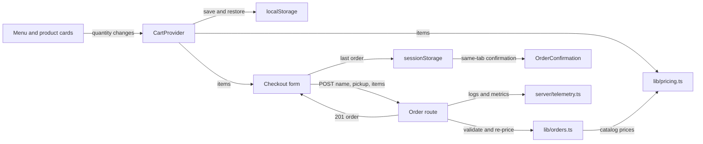
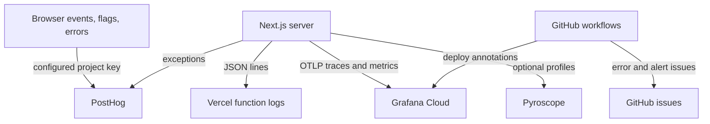

# Architecture

Bean & Byte is one Next.js 14 application using React 18 and strict TypeScript. UI code calls a pure business-logic layer; API routes independently validate and price orders (`package.json`, `tsconfig.json`, `lib/orders.ts`).

At the 2026-11-13 snapshot, committed application and operational source comprises 3,342 physical lines: TypeScript/TSX 1,900 (56.9%), CSS 756 (22.6%), and JavaScript 686 (20.5%). [By the numbers](../by-the-numbers.md) defines the measurement scope, excluding tests, configuration, documentation, assets, lockfiles, and generated files.

## Component boundaries

`app/layout.tsx` mounts the shared `CartProvider`, header, drawer, and analytics bootstrap around every page. `components/Storefront.tsx` renders the static catalog; client product cards update quantities. `components/CartProvider.tsx` delays persistence writes until its initial storage read completes, then stores cart items under localStorage key `bean-and-byte:cart`. Successful checkout clears the items. The provider does not read, write, or remove the former promo key.

| Layer | Important paths | Boundary |
| --- | --- | --- |
| Routes and UI | `app/page.tsx`, `app/checkout/page.tsx`, `app/orders/[id]/page.tsx`, `components/` | Display and interaction, not independent price rules |
| Domain logic | `lib/cart.ts`, `lib/pricing.ts`, `lib/orders.ts`, `lib/products.ts` | No React or I/O |
| Server I/O | `app/api/orders/route.ts`, `app/api/health/route.ts`, `server/` | Validate HTTP input, log safely, export optional telemetry |
| Assets | `public/products/`, `app/globals.css` | Static product photos and site styling |

## Money and order flow

`CartItem` in `lib/types.ts` contains only a product ID and quantity. `priceLines` in `lib/pricing.ts` looks up catalog prices and returns integer-cent `PricedLine` values. The bulk formula uses a fractional rate and `Math.round` to return the nearest whole cent. `formatCurrency` in `lib/currency.ts` handles display.

The order route calls `validateOrderRequest` and `buildOrder` in `lib/orders.ts`, never a browser-supplied total. The resulting order exists in the HTTP response and then in browser session storage, not a database. There is no order retrieval API (`app/api/orders/route.ts`, `components/lastOrder.ts`).

`PROMOTIONS` in `lib/promotions.ts` is empty. Its lookup still trims and uppercases input. The optional `calculateCartTotal(items, promoCode?)` hook in `lib/pricing.ts` would pass all post-bulk lines to a registered callback, subtract its discount, and clamp the result to zero; it no longer filters out bulk lines. No live code or cart/checkout caller activates that path. `OrderRequest` and `Order` in `lib/orders.ts` have no promo field, and current order totals equal the sum of priced lines. See [cart pricing](../features/cart-pricing.md), [checkout](../features/checkout.md), and the historical [lore](../lore.md).

## Optional external services

`components/posthog.ts` loads PostHog only with a configured public project key. `instrumentation.ts` registers server telemetry; `server/instrumentation-node.ts` configures OTLP export and optional Pyroscope profiling. `server/telemetry.ts` wraps handlers, reports failures, and schedules flushing before a serverless function freezes.

No external service is required for local checkout. Configured telemetry does make external calls, so the absence of business API dependencies does not mean the deployed app has no outbound traffic. See [monitoring](../how-to-monitor/index.md) and the measured [language breakdown](../by-the-numbers.md).
